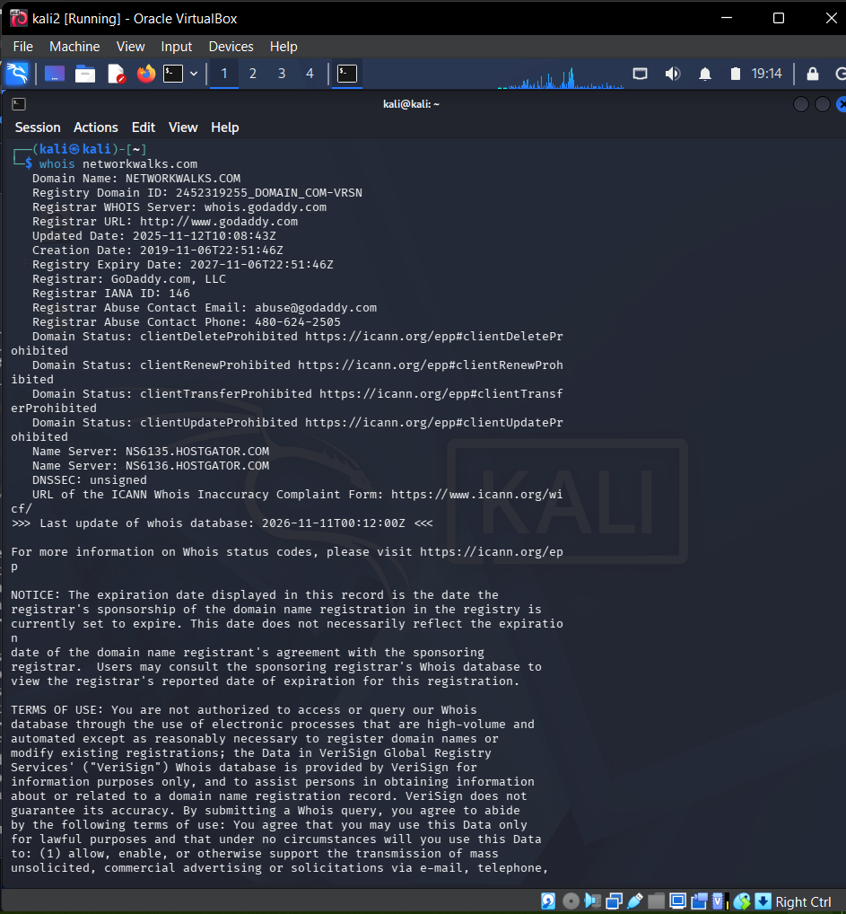
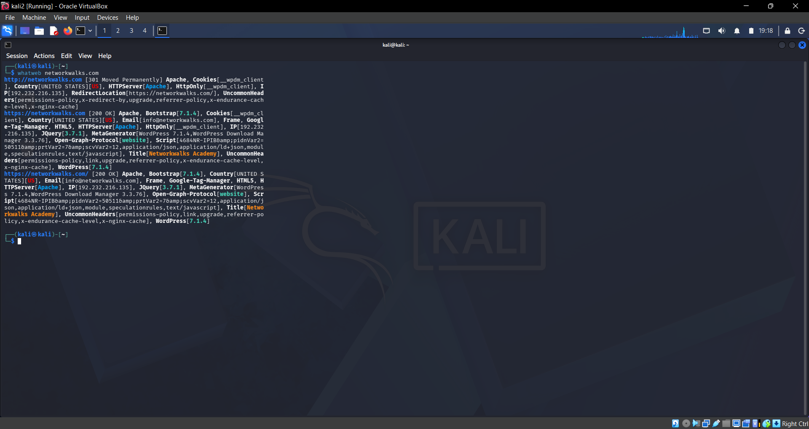
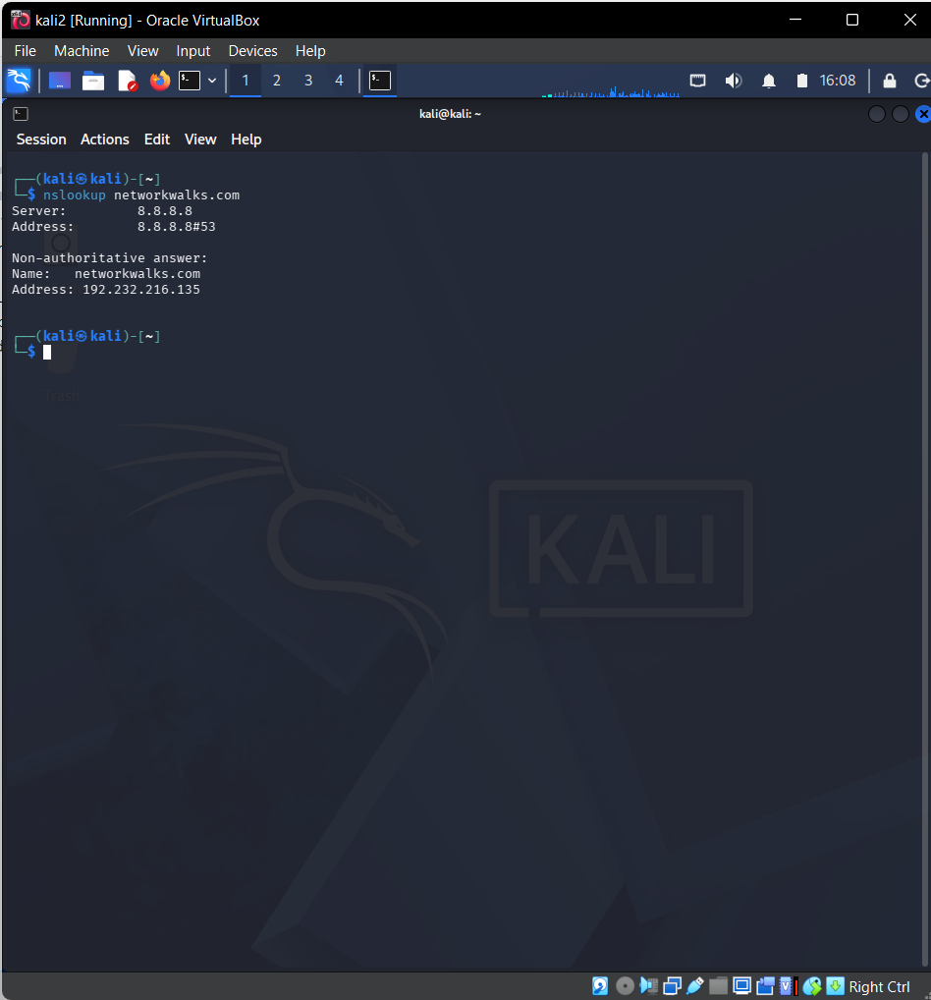
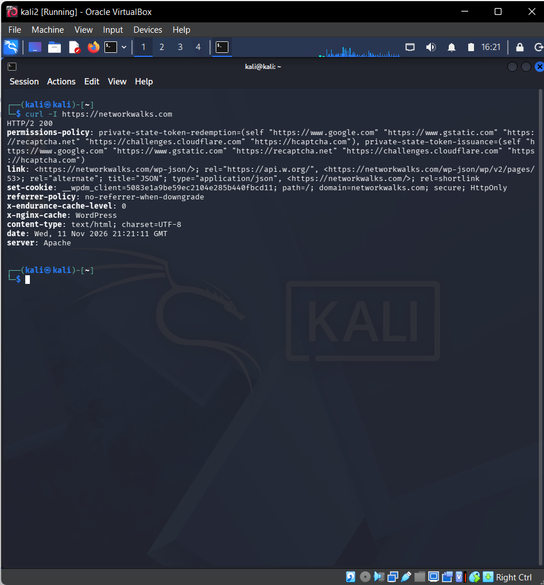
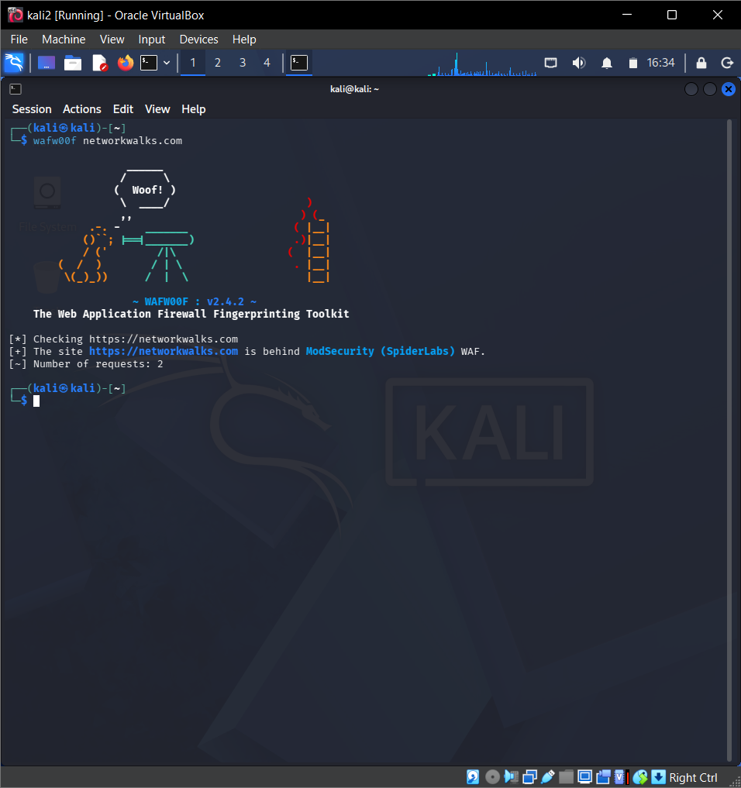
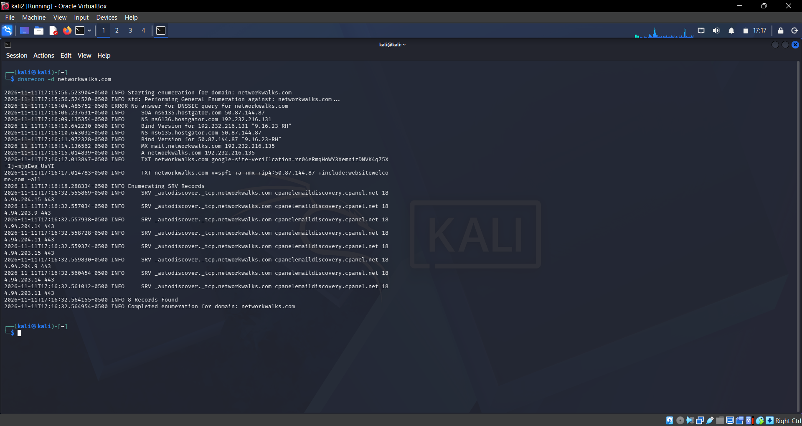
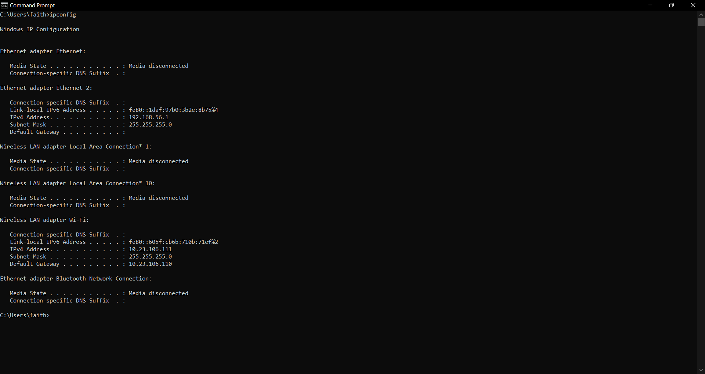
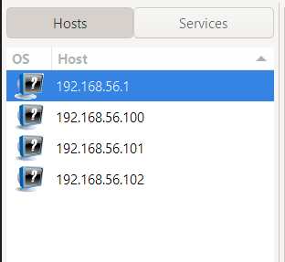
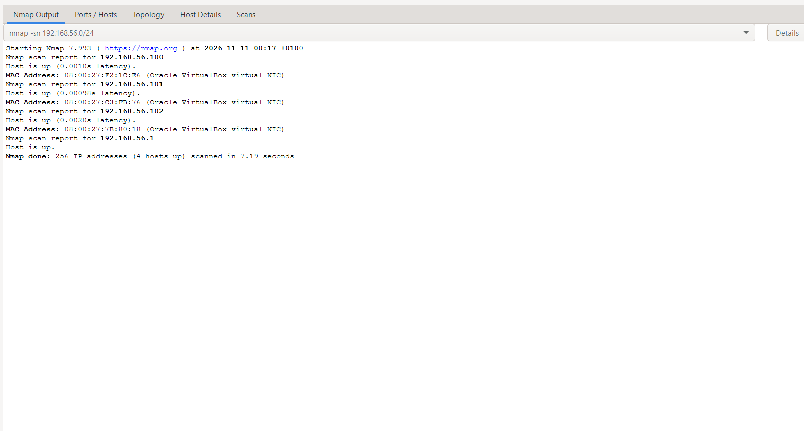
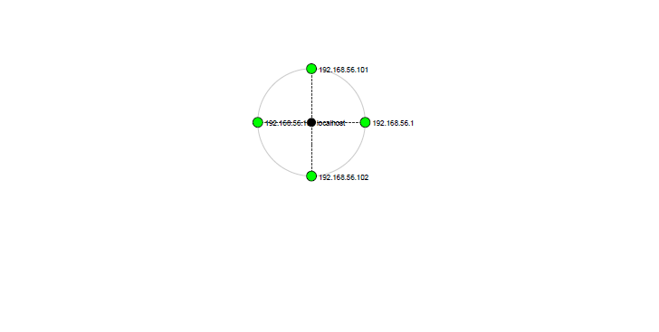

<div align="center">
  
# 🔍 Footprinting & Network Scanning Report

*Reconnaissance and scanning practical using Kali Linux, Nmap, and Zenmap*

</div>

---

## 📌 Project Overview
This project summarizes the practical work I carried out in Week 2 of my Cybersecurity and Ethical Hacking internship with Networkwalks. 

The project covered two major areas: 

- Foot-printing and Reconnaissance using Kali Linux 

- Network Scanning and Host Discovery using Zenmap 

For the foot-printing phase, I collected publicly available information about the authorized domain, networkwalks.com. I used whois, whatweb, nslookup, curl, wafwoof and DNSRecon to gather registration details, web technologies, IP addresses, HTTP headers, firewall indicators and DNS records. 

For the scanning phase, I used Zenmap on my Windows PC to find my local IP address and subnet, detect the live devices on my network, note their IP and MAC addresses, and produce a topology map. 

These exercises showed me how security professionals build a picture of an environment before any deeper testing begins, and why this must only be done with permission. 

## 🎯 Objectives
The goal of this practical was to learn how a security tester collects information about a target and checks what is reachable. Specifically, I set out to: 

- Understand why foot-printing and reconnaissance come before any testing. 

- Gather information about networkwalks.com using Kali Linux tools, including its ownership, IP address, web technologies, headers, firewall and DNS records. 

- Use Zenmap to find my local IP address and subnet. 

- Discover the live devices on my network and note each IP and MAC address. 

- Create a network topology map from the scan. 

- Document everything in a clear, professional report.

## 🛠️ Tools and Purposes

| Tool | Purpose |
|------|---------|
| **Kali Linux** | Main operating system used for all footprinting and testing work |
| **whois** | Looked up who registered the domain and when |
| **whatweb** | Identified the technologies the website is built on |
| **nslookup** | Found the IP address behind the domain name |
| **curl** | Fetched the website's HTTP headers to see how the server responds |
| **wafw00f** | Checked whether a Web Application Firewall protects the site |
| **dnsrecon** | Listed the domain's DNS records |
| **Nmap** | Scanning engine that runs underneath Zenmap |
| **Zenmap** | Graphical front end for scanning my network and drawing its topology |
| **Windows Command Prompt** | Ran `ipconfig` to check my PC's IP address and network details, so I could work out my subnet before scanning |

## ⚙️ Lab Configuration

| Component | Configuration |
|-----------|---------------|
| Host operating system | Windows 11 |
| Hypervisor | Oracle VirtualBox 7.2 |
| Security OS | Kali Linux |
| RAM | 8 GB |
| Processor | Intel Core i7 |
| Network environment | Virtual network |
| Primary target | `networkwalks.com` |
| Secondary target | `scanme.nmap.org` |
| Secondary target IP | 45.33.32.156 |

<div align="center">
  
## Part 1 - 🔍 Footprinting and Reconnaissance

</div>

Footprinting means collecting information about a target before any deeper security testing. Here, I used Kali Linux tools to learn about the publicly visible side of `networkwalks.com`, from its registration details to its DNS records.

---

### 1. 📇 WHOIS Lookup

| | |
|---|---|
| **Tool** | whois |
| **Target** | `networkwalks.com` |

#### Command

```bash
whois networkwalks.com
```

#### Purpose
To collect the public registration record of the target domain, including the registrar, key dates, and the authoritative name servers.

#### Findings

| Item | Result |
|------|--------|
| Registrar | GoDaddy.com, LLC |
| Creation date | 2019-11-06 |
| Expiry date | 2027-11-06 |
| Name servers | NS6135.HOSTGATOR.COM, NS6136.HOSTGATOR.COM |
| Hosting | HostGator |
| Domain status | Locked (clientDeleteProhibited, clientTransferProhibited, etc.) |

#### Observations

- The domain was registered through GoDaddy in November 2019 and is registered until November 2027.
- The name servers belong to HostGator, which suggests the site's DNS and hosting are managed there, separately from the registrar.
- The `client...Prohibited` statuses show the domain is locked against unauthorized deletion, transfer, and updates.
- No registrant details appear in the registry WHOIS output, only the registrar's abuse contact.


#### Evidence:



### 2.  🧩 whatweb: Web Technology Fingerprinting

| | |
|---|---|
| **Tool** | whatweb |
| **Target** | `networkwalks.com` |

#### Command

```bash
whatweb networkwalks.com
```

#### Purpose

To discover the software and technologies behind the target website.

#### Findings

| Item | Result |
|------|--------|
| Web server | Apache |
| CMS | WordPress 7.1.4 |
| Plugin | WordPress Download Manager 3.3.76 |
| Server IP | 192.232.216.135 |
| Redirect | HTTP redirects (301) to HTTPS |

#### Observations

- The site runs on **WordPress** with the **WordPress Download Manager** plugin, served by **Apache**.
- HTTP requests are redirected to HTTPS.
- The site exposes software version numbers, which helps a tester match them against known vulnerabilities.

#### Evidence:

    

### 3. 📍 Nslookup: DNS Resolution

| | |
|---|---|
| **Tool** | nslookup |
| **Target** | `networkwalks.com` |

#### Command

```bash
nslookup networkwalks.com
```

#### Purpose

To find the IP address that the domain name points to.

#### Findings

| Item | Result |
|------|--------|
| DNS server used | 8.8.8.8 (Google Public DNS) |
| Domain | networkwalks.com |
| IP address | 192.232.216.135 |
| Answer type | Non-authoritative |

#### Observations

- The domain name resolved to the IP address `192.232.216.135`.
- This is the same IP address WhatWeb reported for the site, so both tools agree.
- The answer was non-authoritative, meaning it came from Google's DNS server and not from the domain's own name servers.
- Resolving a domain to its IP address is a basic reconnaissance step, because it shows which server to look at next.

#### Evidence:



---
### 4. 📨 Curl: HTTP Response Headers

| | |
|---|---|
| **Tool** | Curl |
| **Target** | `https://networkwalks.com` |

#### Command

```bash
curl -I https://networkwalks.com
```

#### Purpose

To check how the web server responds to a request by reading its HTTP headers.

#### Findings

| Item | Result |
|------|--------|
| Response code | HTTP/2 200 (OK) |
| Web server | Apache |
| Cache header | `x-nginx-cache: WordPress` |
| Cookie set | `__wpdm_client` (Secure, HttpOnly) |
| Referrer policy | `no-referrer-when-downgrade` |
| API link | WordPress REST API (`/wp-json/`) listed in the Link header |

#### Observations

- The `-I` option fetched only the headers, so the full page was not downloaded.
- The headers confirmed the Apache web server found earlier with WhatWeb.
- The Link header points to the WordPress REST API, which further confirms the site runs on WordPress.
- The session cookie is marked Secure and HttpOnly, which are good cookie security settings.

#### Evidence:



---

### 5. 🔥 Wafw00f: Web Application Firewall Detection

| | |
|---|---|
| **Tool** | wafw00f |
| **Target** | `networkwalks.com` |

#### Command

```bash
wafw00f networkwalks.com
```

#### Purpose

To find out if the website sits behind a Web Application Firewall (WAF) and, if so, which one.

#### Findings

| Item | Result |
|------|--------|
| WAF detected | Yes |
| WAF name | ModSecurity (SpiderLabs) |
| Requests sent | 2 |

#### Observations

- The site is protected by a WAF, identified as ModSecurity (SpiderLabs).
- Knowing a WAF is present helps a tester plan how to approach later authorized testing.
- Detecting a WAF does not show how well it is configured or how effective the protection is.

#### Evidence:



---

### 6. 🗂️ DNSRecon: DNS Record Enumeration

| | |
|---|---|
| **Tool** | DNSRecon |
| **Target** | `networkwalks.com` |

#### Command

```bash
dnsrecon -d networkwalks.com
```

#### Purpose

To list the DNS records of the domain and see how its name resolution is set up.

#### Findings

| Record | Result |
|--------|--------|
| A | networkwalks.com → 192.232.216.135 |
| NS | ns6135.hostgator.com (50.87.144.87), ns6136.hostgator.com (192.232.216.131) |
| MX | mail.networkwalks.com → 192.232.216.135 |
| TXT | SPF record and Google site verification record |
| SRV | 8 records found (cPanel email autodiscovery) |
| DNSSEC | No answer to the DNSSEC query |

#### Observations

- The A record and the MX record both point to `192.232.216.135`, so the website and mail share the same server.
- The name servers belong to HostGator, which matches the WHOIS result.
- Both name servers reported their BIND version (`9.16.23-RH`), which is a small version disclosure.
- The SRV records show the domain uses cPanel email autodiscovery.
- The SPF record shows which servers are allowed to send email for the domain.

#### Evidence:



<div align="center">
  
## 🌐 Part 2 - Network Scanning with Zenmap

</div>

This part of the practical moved from a public website to my own lab network. I used Zenmap, the graphical version of Nmap, to see which devices are connected and to draw a map of them.

---

### 1. 💾 Installing Zenmap

| | |
|---|---|
| **Tool** | Zenmap |
| **Platform** | Windows PC |

#### Purpose

To get Zenmap running so I could launch scans and read the results in a visual interface.

#### Procedure

I got the Zenmap installer from nmap.org, the official Nmap site, and installed it on my Windows PC.

#### Findings

| Item | Result |
|------|--------|
| Zenmap version | 7.993 |
| Source | Official Nmap website |

#### Observations

- Zenmap is a visual layer on top of Nmap, so the scans themselves are still run by Nmap.
- Setting up a scan and reading its results is easier here than in the command line.
- Installing from the official site lowers the risk of getting a modified copy of the tool.

---

### 2. 🖥️ Identifying My Local IP and LAN Subnet

| | |
|---|---|
| **Tool** | Windows Command Prompt |
| **Target** | My own PC |

#### Command

```bash
ipconfig
```

#### Purpose

To learn my PC's address on the network so I could work out which range to scan.

#### Findings

| Item | Result |
|------|--------|
| IPv4 address (Ethernet 2) | 192.168.56.1 |
| Subnet mask | 255.255.255.0 |
| Network range scanned | 192.168.56.0/24 |

#### Observations

- My PC has more than one active network adapter, so I had to pick the right one.
- Ethernet 2 has the mask 255.255.255.0, which gives the range 192.168.56.0/24 that I entered in Zenmap.
- Scanning a different adapter's range would have shown a completely different set of devices.

#### Evidence:



---

### 3. 📡 Discovering Live Hosts

| | |
|---|---|
| **Tool** | Zenmap (Nmap) |
| **Target** | `192.168.56.0/24` |
| **Scan profile** | Ping Scan |

#### Command

```bash
nmap -sn 192.168.56.0/24
```

#### Purpose

To see which devices on this network are currently switched on and answering.

#### Findings

The scan found **4 live hosts** out of 256 addresses, in 7.19 seconds:

| No. | IP Address | MAC Address | Status |
|-----|------------|-------------|--------|
| 1 | 192.168.56.1 | 0A:00:27:00:00:04 (my own PC) | Live |
| 2 | 192.168.56.100 | 08:00:27:F2:1C:E6 | Live |
| 3 | 192.168.56.101 | 08:00:27:C3:FB:76 | Live |
| 4 | 192.168.56.102 | 08:00:27:7B:80:18 | Live |

#### Observations

- Four devices answered out of the 256 addresses in the `/24` range.
- 192.168.56.1 is my own PC. Its IP matches the Ethernet 2 address in `ipconfig`, and its MAC address (`0A:00:27:00:00:04`) matches the Physical Address shown in `ipconfig /all`.
- The other three hosts report the MAC prefix `08:00:27`, which Nmap identifies as Oracle VirtualBox virtual NICs, so they are virtual machines.
- My own PC's adapter uses the prefix `0A:00:27`, which is the pattern VirtualBox gives to its host-only network adapter on the host.
- A ping scan only shows which hosts are alive. It does not look at their ports or services.

#### Evidence:





---

### 4. 🗺️ Network Topology

| | |
|---|---|
| **Tool** | Zenmap Topology tab |
| **Target** | `192.168.56.0/24` |
| **Output** | PDF |

#### Purpose

To show the scan results as a picture of the devices on the network instead of a plain list.

#### Procedure

When the scan was done, I switched to the **Topology** tab, checked that all the hosts appeared, and adjusted the view. I then exported it as a PDF, which the practical asked for.

#### Findings

| Item | Result |
|------|--------|
| Centre node | localhost (my own PC) |
| Hosts shown | 192.168.56.1, 192.168.56.100, 192.168.56.101, 192.168.56.102 |
| Number of hosts | 4 |

#### Observations

- The diagram places my PC (`localhost`) in the middle with the other discovered hosts connected around it.
- All four live hosts from the ping scan appear in the map, so it agrees with the scan results.
- Every host connects directly to the centre, which suggests they sit on the same network segment with no routers between them.
- The PDF export gives a saved copy of the network layout that can go into the report.

#### Evidence:



---
##  🛡️ Security Observations and Preliminary Risk Review

The table below lists what stood out during the assessment and why each item matters. The priority ratings are my own preliminary judgement.

| No. | Observation | Why It Matters | Preliminary Priority |
|-----|-------------|----------------|----------------------|
| 1 | Domain registration details are publicly available (WHOIS) | Gives an outsider a starting point for mapping who runs the domain and where it is hosted | Low |
| 2 | Web technology identification | Visible versions can be matched against known flaws, so outdated components could be targeted | Medium |
| 3 | The domain resolves to a single public IP address | Shows which server hosts the site and where further scanning would focus | Low |
| 4 | HTTP response headers | Headers can expose server and application information and may show missing security settings | Medium |
| 5 |Web application firewall (WAF) | Tells an outsider what defensive tools sit in front of the site | Low |
| 6 | DNS records listed publicly | Records such as mail, name server and SRV entries help map the domain's wider infrastructure | Medium |
| 7 | Web ports (HTTP and HTTPS) are open | Every internet-facing port adds to the attack surface that must be kept patched and monitored | Medium |
| 8 | Several services were found on scanme.nmap.org | Shows how much a scan can reveal about a host's exposed services (this is a practice target) | Informational |
| 9 | Operating system detection was attempted | A correct guess can help narrow down platform-specific weaknesses | Low |

### Note:

These are potential security considerations, not confirmed vulnerabilities.

No exploitation or vulnerability verification was carried out. The priorities are preliminary and would need to be checked through further authorized testing.

## ✅ Defensive Recommendations

Based on my observations, these are the steps I would suggest to reduce the exposure that was found.

| No. | Area | Recommendation |
|-----|------|----------------|
| 1 | Domain registration | Check what the public WHOIS record reveals and turn on domain privacy where the registrar allows it. Keep the domain lock enabled. |
| 2 | Software updates | Keep WordPress, the Download Manager plugin and any other web components on their latest versions, and remove plugins that are not needed. |
| 3 | Server protection | Limit direct access to the origin server with network controls such as firewall rules, so only expected traffic reaches it. |
| 4 | HTTP headers | Review the response headers, hide server and version details where possible, and add security headers such as HSTS, X-Content-Type-Options and Content-Security-Policy. |
| 5 | WAF | Keep the ModSecurity rules up to date, tune them to avoid gaps, and read the logs regularly. |
| 6 | DNS | Audit the DNS records from time to time, delete old or unused entries, and consider enabling DNSSEC, since it was unsigned. |
| 7 | Open ports | Turn off services that are not needed and restrict access to sensitive ports to trusted addresses only. |
| 8 | Operating system | Install security patches promptly and use a host firewall to control what can connect. |

*These recommendations are general defensive suggestions based on the observations. They should be reviewed and tested before being applied to any live system.*

## 💡 What I Learned

This practical showed me that a lot can be learned about a target without breaking into anything. With a few simple commands, I found the software a website runs on, its IP address, its firewall and how its DNS is set up, all from public information.

I also learned that each tool answers a different question:

- **whois** tells me who is behind a domain.
- **whatweb** shows what it is built with.
- **nslookup** tells me where it lives.
- **curl** shows how the server talks.
- **wafw00f** shows how it is protected.
- **dnsrecon** shows how it is set up.

With Zenmap, I learned how to find my own subnet with `ipconfig`, discover the devices on my network, and read their IP and MAC addresses. Seeing the topology map made the network much easier to picture than a list of addresses.

Most of all, I learned that visible information is not the same as a vulnerability, and that testing should only ever be done with permission.

## ⚠️ Disclaimer

This project was completed for educational and cybersecurity training purposes, and all activity stayed within an authorized scope.

- **Footprinting:** done only on the authorized Networkwalks target, using publicly available information.
- **Local network scan:** done on my own lab network.
- **Practice scanning:** `scanme.nmap.org` is a target the Nmap project provides for scanning practice.
- **No exploitation:** no exploitation, vulnerability testing, or unauthorized access was attempted.
- **Findings and recommendations:** the findings are observations made during the exercise, and the recommendations are meant to improve security awareness and defensive practice.

Unauthorized access to computer systems may break the law. Only test systems and networks you own or have clear permission to test, and always stay within an approved scope.

## 👧 Author
**Owoseni Fiyinfoluwa Faithfulness**

Cybersecurity Intern at Network Walks

## 📌 Project Information 

**Project:** Footprinting, Network Scanning and Vulnerability Assessment|
**Week:** 02|
**Program Name:** Cybersecurity at Networkwalks|
**Repository:** Github
